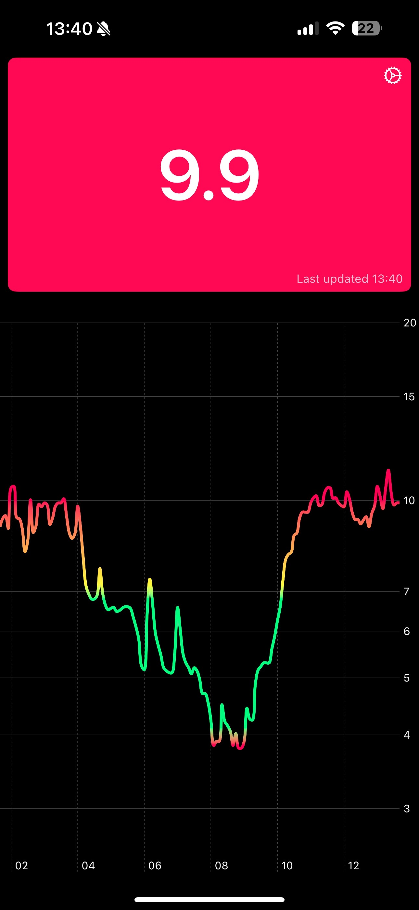
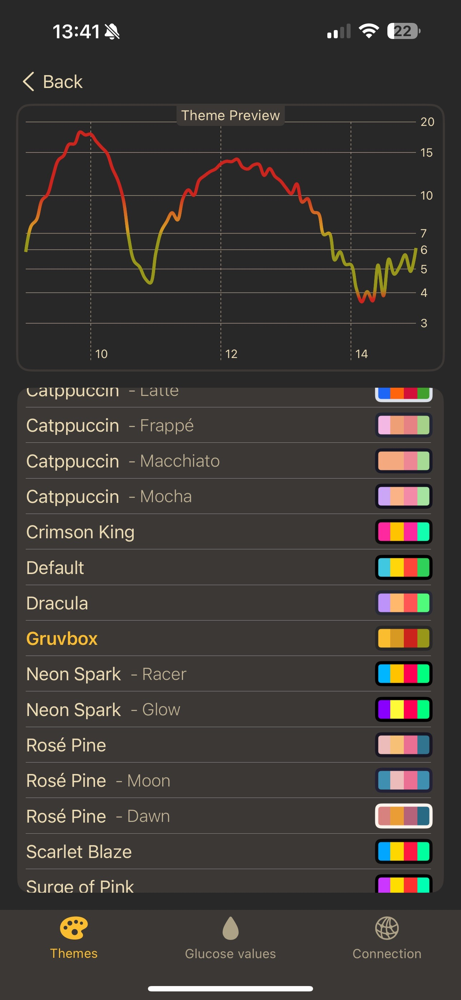
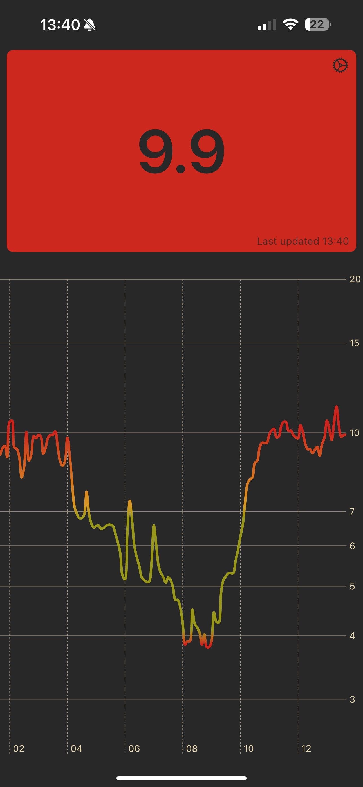

# GlucoScope

GlucoScope is a highly customizable native iOS and Android app for diabetics to display & track their blood glucose levels and visualize them with pretty graphs. It's fully compatible with NightScout servers, but can connect a custom Rust server that leverages InfluxDB to store time series data.

[![AppStore][appstore-image]][appstore-url] [![PlayStore][playstore-image]][playstore-url]

## Screenshots

|    |   |  |
|---------------------|---------------------------|-------------------|

## iOS Libre 2

The iOS app includes an optional Bluetooth mode that stores direct Libre 2
readings locally and presents them in Graph, Stats, Sensor, and Settings tabs.
Viewer mode remains available for Nightscout and the custom backend. See the
[app experience decisions](docs/ios-ble-app-experience-plan.md), [integration
audit](docs/ios-ble-app-integration-audit.md), and [physical testing record](docs/libre2-ble-testing.md).

## Stats

[appstore-image]: docs/appstore.png
[appstore-url]: https://apps.apple.com/us/app/glucoscope/id6745609594?platform=iphone
[playstore-image]: docs/playstore.png
[playstore-url]: https://play.google.com/store/apps/details?id=com.bitechular.glucoscope
