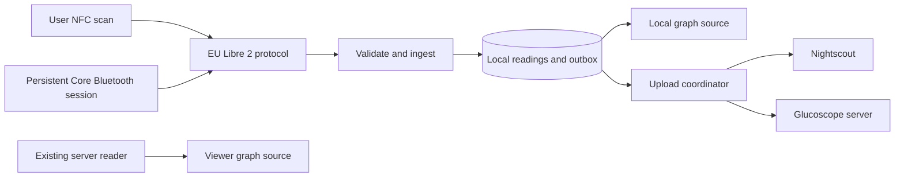

# iOS Libre 2 Bluetooth mode implementation plan

This document is both the implementation plan and the complete handoff for continuing the work. It was updated on 10 September 2026 after the first physical-sensor tests. The original target architecture remains below; items which are not explicitly listed as implemented are planned and unimplemented.

## Start here for the next session

The current source identifies itself as **Experimental glucose decoding v5 (persistent sensor clock)** in diagnostics. Calibration, experimental decoding, restoration and read-only recapture were exercised in v4; the separate persistent clock anchor is the latest change and still needs user execution. Agents performed independent static reviews, whitespace checks, Xcode project syntax validation and shell syntax validation. They did not compile Swift, run the regression suites or launch the app.

1. Have the user run `./ios/Libre2Tests/run.sh` and build v5 over the existing installation. Do not delete the app, forget the sensor or repeat streaming setup for this check.
2. Export after collection resumes, then perform a deliberate **Read calibration with NFC**, wait for another valid frame, and export again. Calibration capture metadata should advance while the clock reference, overlapping sample timestamps, pairing and counter remain unchanged unless an independent reconnect reserves another counter. Relaunch and check the same retained clock. Migration uses the latest calibration still stored by v4; it cannot reconstruct an earlier overwritten clock estimate. Stable timestamps do not remove the initial NFC minute-resolution or phone-clock uncertainty.
3. After resolving any v5 failures, the next implementation milestone is transactional local ingestion: persist accepted readings and their delivery state before canonical display/upload, deduplicate by sensor session and sample minute/kind, and retain sparse gaps. Normal graphs, backend delivery and NFC history ingestion remain unimplemented. Keep experimental values separate until that foundation exists.

The user also uses a second physical phone to obtain their usual glucose readings. During this session they switched the sensor between collectors and later deliberately repeated development-app NFC setup to resume frames. Two-phone coexistence and takeover/recovery behavior are not qualified; do not trigger NFC or streaming setup automatically. Accuracy still needs independent timestamp-matched comparisons, and broad reconnect/restoration, longer locked-screen runs, storage fault handling and other sensor revisions remain open.

The connection diagnostic phase is implemented. The temporary home screen bypasses the existing viewer and polling UI and exposes NFC setup, BLE state, raw encrypted frames, decrypted CRC-valid payloads, logs, and diagnostic upload. On one non-Plus `7F` Libre 2, NFC identity and patch interrogation, the 344-byte FRAM read and lifecycle CRC validation, streaming enablement, `FDE3`/`F001`/`F002` discovery, counter-1 unlock, and repeated frame receipt all succeeded. Two foreground frames arrived 59 seconds apart. A later 5 minute 11 second locked-phone test received five more frames at 59–62 second intervals with no logged disconnect or additional unlock, bringing that session to eight raw and eight CRC-valid frames.

This does not establish glucose accuracy, general reconnect/restoration reliability, 72-hour reliability, or compatibility with `9D` and `C5` sensors. A pure decoder and transient experimental display have now been built and exercised by the user on one non-Plus `7F`; the user reports that values appear in line. This is qualitative feedback, without an independent timestamp-matched comparison or accuracy tolerance. The first two NFC attempts lost the tag during the initial `A1` patch query. Bounded read retries and same-tag reacquisition were then added; the later scan succeeded on its first read attempts, so there is no evidence that retries caused the success.

The exact physical evidence is from an iPhone on iOS 18.7.8 and app `1.0.6 (1)`. NFC patch information and all 344 FRAM bytes passed lifecycle CRC validation on the successful scan, followed by streaming enablement. BLE found the expected service and characteristics, reserved unlock counter 1 before sending it, and received two CRC-valid frames 59 seconds apart. During the locked-phone interval from 18:11:26 through 18:16:37 UTC, five frames arrived at 18:12:22, 18:13:24, 18:14:24, 18:15:23, and 18:16:23: intervals of 62, 60, 59, and 60 seconds. There were no logged disconnects, further unlock attempts, or CRC failures. Raw identifiers and payloads remain only in local exports.

## Current implementation and source map

| Area | Current implementation |
| --- | --- |
| App lifecycle | `GlucoScopeApp.swift` creates the app-owned diagnostics coordinator at launch. `LibreBluetoothCentral` uses a serial queue and restoration identifier. |
| NFC setup | `Sensor/Libre2/LibreNFCSession.swift` identifies supported revisions, reads/decrypts all FRAM, validates lifecycle CRCs, enables streaming, and implements bounded read retry/reacquisition. Setup is always a deliberate user NFC action. |
| Protocol | `Sensor/Libre2/Libre2Protocol.swift` contains sensor classification, authentication, decrypt, CRC and FRAM primitives. `LibreFrameAssembler.swift` bounds 46-byte frame assembly; the BLE central applies the fragment timeout. |
| Pairing state | `LibreSensorSession.swift` models pairing state. `LibreSessionStore.swift` stores it in Keychain; the BLE central persists each unlock counter reservation before use. Versioned calibration and a separate session-stable `LibreSensorClockAnchor` are persisted; legacy records retain pairing and seed an absent anchor from valid calibration. Physical identity excludes mutable patch bytes 4–5, while the full paired patch remains unchanged for BLE authentication. Full FRAM is discarded. |
| BLE | `LibreBluetoothCentral.swift` retrieves a known peripheral or performs exact-name foreground discovery, discovers `FDE3`/`F001`/`F002`, subscribes, unlocks, validates frames, keeps connection requests pending, and has preliminary restoration/reconnect handling. |
| Experimental decode | `Libre2DiagnosticDecoder.swift` independently parses CRC-valid payloads using sensor-owned calibration. The diagnostics screen retains only the latest transient frame result, including rejected slots; values are not canonical readings and are not saved, graphed or uploaded. |
| Diagnostics | `LibreDiagnosticsCoordinator.swift`, `LibreDiagnosticsView.swift`, and `LibreDiagnosticsUploader.swift` drive the temporary home screen and local diagnostic uploads. `AppView.swift` currently routes directly to this screen. |
| Tests | `ios/Libre2Tests/` contains synthetic authentication, FRAM, decrypt/CRC, frame assembly, classification, counter, NFC retry and numerical decoder fixtures. No execution log for the newest fixture set has been supplied, and fixtures do not validate hardware callbacks or clinical accuracy. |

## Next phase: calibrated readings and durable ingestion

Steps 1–2 below are implemented in source: `LibreCalibration.swift`, safe session migration, initial setup capture, and the deliberate read-only calibration action. The action merges into the latest BLE-owned session without resetting its counter, peripheral, collection state or frame counts. The user-run v3 export at 18:37:13 UTC on 10 September 2026 confirms identity-checked read-only calibration capture and save on the same non-Plus `7F`, with no streaming-enable command, stop or reconnect during the capture. Calibration reports format 1, sensor minute 4277 and lifecycle 3. Step 3 now has a pure decoder and diagnostics-only presentation exercised in the user-built app. Its numerical output still requires independent timestamp-matched comparison. No reading persistence or canonical ingestion from step 4 exists. The user reports a successful build; no automated regression-suite result for the newest fixture set has been supplied. Corrected mutable-word recapture now passes; upgrade migration from a legacy paired installation remains unverified on hardware. See `libre2-ble-testing.md` for the next device checks.

The v3 report was exported 13 seconds after foreground BLE discovery began, with Bluetooth powered on, zero frames and no connection error. A preceding v2 report shows a deliberate full setup at 18:36:37–38, after 28 CRC-valid frames, resetting the next counter to 1 and clearing the discovered peripheral. The v3 capture preserved that latest identity and counter-1 state; it cannot establish preservation of the older connected pairing state. This brief discovery snapshot does not establish BLE failure.

A subsequent same-sensor scan exposed that patch bytes 4–5 changed after streaming enablement even though the UID and every stable patch byte matched. Exact patch equality incorrectly rejected that scan. Corrected source treats those bytes as mutable operation material: the current query supplies them for FRAM decryption, calibration ownership uses the remaining stable identity, and saved pairing credentials retain their original full patch. The corrected path later saved two read-only captures from that same streaming sensor while preserving the paired patch, peripheral and counter. The first was followed by a CRC-valid frame six seconds later without streaming enablement, reconnect, disconnect or another unlock. The second export was only ten seconds after saving, so it does not establish post-capture frame continuation by itself.

The user-run v4 export then recorded one actual Core Bluetooth `willRestoreState` callback retrieving the saved peripheral and calibration without NFC setup. It reserved counter 2 once and received three raw and three CRC-valid frames over 112 seconds. The decoder accepted 7/7, 7/7 and 6/7 sparse slots; the final 15-minute slot was rejected for zero raw glucose. Sensor-anchored newest-sample timestamps lagged packet receipt by 8, 2 and 0 seconds. No errors or disconnects were logged. This proves one restoration callback and an operating diagnostic decoder on the tested sensor, not general restoration reliability or glucose accuracy. The user's statement that values seem in line is qualitative; independent timestamp-matched comparison remains pending.

In the user-built v4 behavior, both corrected recaptures reported the same sensor minute but occurred 22 seconds apart. Recomputing the timestamp anchor from each capture shifted the inferred sensor-start time by 22 seconds; the first corrected anchor was also 6 seconds earlier than the prior saved anchor. The stable-clock v5 source increment therefore persists the first valid anchor separately from changing calibration metadata and preserves it across recaptures and restarts. Legacy records with valid calibration seed the new field once. A present malformed/null anchor remains unavailable rather than silently reanchoring. This v5 source and its migration fixtures have not yet been built or run by the user.

Preserve the working NFC/BLE path while implementing these steps:

1. Extract calibration data from validated NFC FRAM and persist it with the sensor session. Migrate the existing Keychain `LibreSensorSession` schema safely: its current Codable records have no calibration fields. Decode old records without deleting them, report a needs-calibration state, and preserve the peripheral ID, unlock code, and next reserved counter.
2. Acquire missing calibration through a deliberate, identity-checked, read-only NFC capture. It must not automatically send the `A1/1E` streaming-enable command, reset pairing, or replace the sensor. Never initiate NFC without the user.
3. Build a pure, independent decoder that accepts calibration plus a CRC-valid BLE payload. Validate sensor lifecycle/minute, sparse offsets, raw field ranges, temperature/adjustment inputs, and zero or otherwise invalid raw slots before producing values. Preserve the BLE sample offsets `0, 2, 4, 6, 7, 12, 15` minutes and derive timestamps from the sensor-minute anchor rather than packet receipt time.
4. Keep proof calculations isolated to diagnostics and fixtures until persistence exists. Once values become canonical app readings, commit each accepted reading through the transactional local store before displaying it, graphing it, or scheduling upload. Deduplicate sparse/repeated frames by sensor session and sample position. Normal graph integration and durable Nightscout/Glucoscope upload remain later work.

Continue through bounded, reviewable iterations and request physical sensor tests when useful. Do not ask for routine permission, change sensors, or perform another streaming setup automatically.

When bounded workers are useful, the coordinator may choose their model and effort freely. Give each worker an independent task and clear file ownership; the root agent reviews and integrates their work and performs static checks, while the user owns builds, test execution and app/device runs. Stop or interrupt each worker immediately when its assigned work completes. Do not maintain an idle worker pool.

## Development and diagnostics environment

The local receiver is intentionally left running in tmux session `GlucoScope`, window `1`, pane `%52`:

```sh
python3 -u scripts/diagnostics_server.py --host 0.0.0.0 --port 8765
```

Its endpoint is `http://10.0.0.22:8765/diagnostics`; `GET /health` checks reachability. It accepts UTF-8 `text/plain` POST bodies up to 1 MiB and returns HTTP 201 with the saved filename. Files are mode `0600` under `/tmp/glucoscope-diagnostics`; this temporary directory is not durable storage. The app automatically pushes a snapshot after an NFC result and offers **Send diagnostics** for later BLE state; therefore the automatic NFC upload may pre-date discovery and frames. Find reports by modification time, not lexical filename ordering. Do not commit exported logs, raw identifiers, or packet payloads. The receiver URL is editable, and the current numeric IP has a specific ATS exception which must be updated if the address changes.

`docs/xdripswift` is an untracked local reference checkout. Keep it out of commits and app/runtime dependencies. It reports commit `53b3d6bf1b550c99b19c3d5d2c2f80dd226465d8`; `docs/libre2-eu-protocol.md` records SHA-256 hashes for every inspected file and the supplied GPL-3.0 license. The implementation is independently written, and that is not a legal-clearance claim.

Run the portable regression suite with:

```sh
./ios/Libre2Tests/run.sh
xcodebuild -project ios/GlucoScope.xcodeproj -scheme GlucoScope -configuration Debug -sdk iphonesimulator -destination 'generic/platform=iOS Simulator' CODE_SIGN_IDENTITY=- build
xcodebuild -project ios/GlucoScope.xcodeproj -scheme GlucoScope -configuration Debug -sdk iphoneos -destination 'generic/platform=iOS' CODE_SIGNING_ALLOWED=NO build
```

Xcode 26.2 simulator and generic iPhone compilation passed for the earlier connection revision, with only existing warnings; this is not a build result for v5. Use normal ad-hoc signing for simulator launches: a wholly unsigned simulator app produced Keychain error -34018, resolved by signing. Local device testing needs normal development signing with the NFC Tag Reading capability/profile. The deployment target remains iOS 16.4 and the tested build reports app version `1.0.6 (1)`.

## Planned target architecture

Implement an independent, offline-capable Libre 2 collector alongside the existing viewer. Commit every valid reading to local storage before displaying it or attempting upload. Keep sensor collection, graph presentation, and backend delivery separate so network failures cannot interrupt BLE collection.

**Scope and working assumptions**

- iOS client only, retaining the current iOS 16.4 app deployment target. Use Core Data rather than requiring iOS 17 for SwiftData. Android remains outside this work; the Rust server changes below are required to accept uploads.
- One active EU FreeStyle Libre 2 sensor and one selected upload destination: Nightscout or Glucoscope.
- Target EU Libre 2 revisions identified in the reference as `9D`, `C5`, and the non-Plus `7F` variant. Validate each on hardware before claiming support. Exclude Libre 1, Libre 2 US, Libre 2 Plus, and Libre 3. Reject incomplete or unknown patch information explicitly.
- Start with an already activated sensor. Enabling BLE streaming is part of setup; starting a new sensor's wear period, resetting it, or extending its lifetime is outside this first release.
- Decode glucose locally using sensor-specific calibration information. Collection and decoding must work without LibreLinkUp or an external algorithm service.
- Existing installations remain in Viewer mode after upgrading. Bluetooth mode can collect while its upload destination is temporarily unavailable or still being configured.

**Important findings from the reference**

| Finding | Consequence for Glucoscope |
| --- | --- |
| `CGMLibre2Transmitter.startScanning()` starts an NFC session; `LibreNFC` reads identity, patch information and memory, then enables BLE streaming. | Initial pairing needs an NFC-capable iPhone and a deliberate sensor scan. A Bluetooth device picker alone is insufficient. |
| The BLE service is `FDE3`, with `F001` for writes and `F002` for notifications. Frames are 46 encrypted bytes and use a streaming unlock exchange. | Build a sensor-specific protocol implementation, including decryption and integrity checks. |
| The actual BLE parser reads seven measurements at offsets 0, 2, 4, 6, 7, 12 and 15 minutes. Some nearby comments describe older behavior. | Reconnecting can recover a sparse recent window, not hours of minute-by-minute history. Validate packet behavior rather than reproducing comments. |
| The NFC parser handles 16 recent trend slots and 32 history slots spaced 15 minutes apart. | Provide NFC backfill for approximately eight hours, subject to sensor age and valid stored slots. |
| Newer non-Plus `7F` sensors use a MAC-derived advertised name, unlike the older `ABBOTT` plus serial naming. | Store the identity returned by NFC; do not assume all EU sensors share a name format. Core Bluetooth still uses its own peripheral UUID. |
| The direct Libre 2 NFC callback in the reference extracts calibration parameters; the general FRAM parser contains history decoding. | Wire NFC history into our common ingestion pipeline explicitly; copying the connection flow would not by itself implement backfill. |

These protocol observations originated in the supplied source; the connection subset described above has since been exercised on one physical non-Plus `7F` sensor. In particular, **“backfill with a Bluetooth scan” means reconnect and recover whatever recent samples the BLE frames expose**. For a longer gap, the UI must offer **“Scan sensor for history (NFC)”**. There is no demonstrated arbitrary BLE history-download command in this reference.

**1. Establish an independent protocol specification and hardware proof**

Before building the full settings flow, create `docs/libre2-eu-protocol.md` and a small diagnostic harness with these deliverables:

- Record the reference snapshot identity/checksums, relevant files, observed field layouts, byte ordering, CRC rules, streaming unlock inputs, counter behavior, and sensor classification rules.
- Describe the calibration extraction and temperature conversion mathematically, including the provenance of constants and lookup data. These are part of the decoding work, not optional polish.
- Implement new Swift types from that specification. Do not copy xDrip files, class hierarchies, utility bodies, or tables wholesale. Preserve source references for each derived behavior; record the supplied GPL-3.0 license without treating a rewrite as a legal clearance claim.
- Capture our own permitted NFC/BLE test fixtures. Keep xDrip outside the app target and runtime dependencies. Use reference outputs as a comparison oracle during development, with the selected xDrip algorithm configuration recorded.
- Prove NFC identity/calibration reads, BLE streaming enablement, notification subscription, unlock and repeated valid frame decoding on real EU sensors. Resolve whether a fresh activation workflow is necessary separately from streaming setup.
- Check coexistence with the official Libre app and other collectors. The reference warns about scanning with LibreLink after pairing; verify takeover behavior and give concrete recovery guidance during setup.

Exit criteria: a repeatable connection to a supported sensor, verified locally calculated glucose, and an initial locked-screen/background run. Treat unavailable calibration data, unexplained decoding differences, and unverified sensor revisions as explicit release blockers. Establish conversion tolerances before fixture acceptance; matching xDrip alone does not prove agreement with the official sensor algorithm.

**2. Introduce the collector architecture and persistent data model**



Create an app-owned `CollectionCoordinator`, independent of SwiftUI view lifetimes. It owns `LibreNFCSession`, `LibreBluetoothCentral`, a pure Swift `Libre2EUProtocol`, and a transactional `ReadingStore`. A separate `UploadCoordinator` consumes the persisted outbox. Present published status on the main actor; serialize Core Bluetooth operations on a dedicated queue and database writes through a single writer.

Keep the existing `DataSource` protocol for graph queries. Add `LocalSensorDataSource`; make `RealtimeDataService` observe local commits in Bluetooth mode and retain server polling in Viewer mode. Do not implement BLE as a repeating network-style fetch. Introduce an `AppMode` preference rather than conflating operating mode with backend type.

| Persistent entity | Required information |
| --- | --- |
| Sensor session | Stable session ID, UID, patch information/revision, expected BLE identity, peripheral UUID, calibration version/data, sensor-age clock anchor, lifecycle state and streaming setup state. |
| Reading | Stable ID, sensor session, sensor minute, sample kind/resolution, captured UTC timestamp, received timestamp, canonical glucose in mg/dL, quality, origin (`bleLive`, `bleHistory`, `nfcTrend`, `nfcHistory`) and decoder version. |
| Upload destination | Stable destination ID, backend kind, normalized URL, credential reference, configuration revision and enabled state. |
| Outbox item | Reading ID, destination ID, immutable payload/version, status, attempt count, next eligible attempt, last error, background task/batch identity and acknowledgement time. |

Use unique constraints and one transaction to save the reading and its outbox item. Readings captured before destination setup remain explicitly unassigned and are enqueued transactionally when a destination is selected. Persist the sensor minute and establish a stable UTC anchor; never timestamp recovered samples as if they were newly measured. Test phone clock corrections, restart, timezone changes, sensor replacement and counter rollover.

Deduplicate by sensor session and sample position/kind. BLE and NFC trend records for the same minute represent one canonical trend reading; keep coarse NFC history distinct internally. For graph/upload overlap, prefer an actual trend measurement over a history sample at the same timestamp. Freeze an upload payload once dispatched; later recovered history must not silently rewrite an acknowledged live reading. Preserve meaningful gaps instead of manufacturing samples by interpolation.

Retain unacknowledged readings without an age-based purge. Default to keeping at least 90 days of acknowledged local history; apply cleanup only to eligible acknowledged data. Use protected local storage that remains accessible while locked after first unlock, including database sidecar and upload files. Store credentials and sensitive pairing material in Keychain with compatible accessibility. Report storage failures explicitly; a reading is not safely queued until its transaction commits.

**3. Make continuous BLE collection the core reliability feature**

Maintain one long-lived `CBCentralManager` with a stable restoration identifier and implement `centralManager(_:willRestoreState:)`. Initialize the coordinator at process launch using an app delegate bridge, including background launches, rather than waiting for a screen to appear. Restore peripheral delegates, discovered characteristics, subscriptions and pending connection state before initiating new work. Apple's [Core Bluetooth background guide](https://developer.apple.com/library/archive/documentation/NetworkingInternetWeb/Conceptual/CoreBluetooth_concepts/CoreBluetoothBackgroundProcessingForIOSApps/PerformingTasksWhileYourAppIsInTheBackground.html) describes this lifecycle.

Use an explicit state machine:

`disabled → needsSetup → waitingForBluetooth → discovering → connecting → subscribing → unlocking → streaming`

Handle recoverable disconnects through `reconnecting`; expose distinct permission, sensor-state and repair-required conditions. Treat “connected” and “receiving valid readings” as different statuses.

- Restore/retrieve the known peripheral first and keep an OS-managed connection request pending when it is out of range. Avoid repeatedly cancelling a healthy pending connection.
- Perform first discovery in the foreground immediately after NFC setup. The reference uses an unfiltered scan for Libre 2. Verify whether each revision advertises `FDE3`; do not assume a discoverable GATT service is advertised or that name-based discovery works in the background.
- Subscribe to the expected characteristic and perform the verified unlock sequence. Persist counter reservations before sending commands; serialize attempts so crashes and duplicate callbacks cannot reuse authentication state incorrectly. Define repair behavior for partial NFC enablement and counter exhaustion.
- Frame notifications with strict size bounds, fragment timeout, overflow handling and a fresh buffer per connection generation. Decrypt and verify CRC before parsing. Validate sensor age/state, calibration ownership and numeric results before persistence or upload.
- Track time since the last valid frame. Use event-driven checks and foreground/delegate opportunities to detect a stalled stream; foreground timers may assist but cannot be the background recovery mechanism. Reconnect with bounded recovery attempts and avoid radio-intensive loops.
- Keep callback work short: decode, persist and schedule delivery. Never wait for backend HTTP requests on the BLE queue.
- Add `bluetooth-central`, `NSBluetoothAlwaysUsageDescription`, NFC usage description and the NFC Tag Reading capability/`TAG` entitlement. Check the runtime NFC capability before setup. See Apple's [NFC entitlement documentation](https://developer.apple.com/documentation/bundleresources/entitlements/com.apple.developer.nfc.readersession.formats).

iOS cannot guarantee uninterrupted collection after the user force-quits the app; restoration also depends on pending Bluetooth work and device state. After reboot, protected state is unavailable until first unlock. Explain these concrete recovery cases in the collector UI and test them on supported iOS versions; see Apple's [restoration conditions](https://developer.apple.com/library/archive/qa/qa1962/_index.html). Do not use audio, location, or frequent background-fetch timers to keep the process alive.

**4. Implement recent BLE recovery and longer NFC backfill**

Provide separate actions with truthful labels:

- **Reconnect / recover recent readings:** retrieve or discover the paired sensor if disconnected, authenticate, then ingest the actual historical slots in arriving BLE frames. If already streaming, keep the connection and process incoming history; do not disconnect merely to “scan.” Show how many missing samples were recovered and which gaps remain.
- **Scan sensor for history (NFC):** read and decrypt the 344-byte FRAM image, validate its sections, then decode trend/history rings using their cursor positions and sensor-age timestamps. Handle the history publication delay and ring wrap described in the reference. Import all valid missing readings through the same transaction/outbox path.

A history-only NFC read should preserve streaming credentials and the existing BLE session where the verified protocol permits. Make streaming re-enablement an explicit repair/setup operation, because it can change connection state. Reject scans of another sensor during backfill; route sensor replacement through setup while retaining the old session and pending uploads.

Do not promise full minute-resolution recovery across a long outage: NFC history is coarser, and readings older than the available ring buffer may be unrecoverable. Separately, readings already stored on the phone survive an arbitrarily longer network outage, subject to available storage.

**5. Build durable delivery to both backends**

Create a `GlucoseUploadDestination` abstraction with Nightscout and Glucoscope adapters. Allow only one worker to claim a batch. Use at-least-once transport with idempotent server writes and deterministic payloads; an HTTP request being sent is not an acknowledgement.

- Drain eligible items after local commits, foreground launch, usable-network changes and transfer completion. Persist retries with exponential backoff and jitter; honor `Retry-After` for throttling. Network callbacks are opportunities to run, not a guarantee of background execution.
- Use a background `URLSession` with persisted file-backed upload batches, stable identifiers and delegate completion handling. Reconcile OS tasks with stored batch state on relaunch before reclaiming work. Coordinate any foreground fast path through the same batch ownership so it cannot race background delivery. Apple's [background transfer documentation](https://developer.apple.com/documentation/foundation/downloading-files-in-the-background) specifies file-backed uploads and relaunch handling.
- Commit acknowledgement only after the adapter validates HTTP status and the response's acceptance semantics. Recover correctly when the server committed but the response was lost, or the app terminated before saving the acknowledgement.
- Pause a destination on authentication failure and retain all data. Quarantine invalid records for inspection while allowing valid records through. Handle partial acceptance, oversized batches and server errors without deleting queued readings.
- Tie delivery state to destination identity. Changing credentials for the same destination preserves its queue. Changing server URL creates a new destination; offer an explicit pending-reading transfer choice rather than silently sending old data to another server.

For **Nightscout**, post SGV batches to `/api/v1/entries` using integer mg/dL, epoch milliseconds, ISO timestamps, `type: sgv` and a stable device label. Support explicit API-secret and access-token credential types; verify write permission rather than treating a successful status read as an upload test. Derive a trend direction only from sufficient valid recent data. See the [Nightscout API specification](https://github.com/nightscout/cgm-remote-monitor/blob/master/lib/server/swagger.yaml).

Verify duplicate behavior on the supported Nightscout releases. Current upstream [entry storage](https://github.com/nightscout/cgm-remote-monitor/blob/master/lib/server/entries.js) upserts typed entries by timestamp and type; keep timestamps/payloads stable across retries and test accepted-but-response-lost scenarios. Do not assume that an arbitrary client UUID or idempotency header provides deduplication across all deployed versions. Document compatibility with another uploader targeting the same timestamps.

For **Glucoscope**, add authenticated `POST /api/s1/entries` to the Rust server. Specify bounded batches containing `reading_id`, session/source identity, time in epoch seconds, and value in mmol/L to match the existing read contract. Return accepted IDs only after successful database writes. Define deterministic Influx point identity so retries overwrite the same point; do not add a fresh receipt timestamp to the identity. Include a contract test for retry after partial persistence.

The server also needs an upload-only operating configuration: LibreLink credentials become conditional, and `main.rs` must start the HTTP server without requiring successful LibreLink authentication. Add an explicit ingestion-source setting so the cloud poller does not concurrently overwrite or duplicate BLE uploads. Preserve the existing viewer response schema, with source-aware queries if storage tags change. Require configured authorization for the new write route even where legacy reads are public, and redact configuration secrets from logging.

**6. Add the mode switch and collector status**

Place a segmented **Viewer / Bluetooth** control at the top of Settings → Connection. Extend onboarding with the same choice.

| Mode or action | Behavior |
| --- | --- |
| Viewer | Existing server configuration and polling; BLE collection disabled. Preserve prior sensor setup and local readings. |
| Bluetooth | Show local readings immediately, sensor setup/status, upload destination, last valid reading, queued count and last successful upload. |
| First Bluetooth setup | Check Bluetooth/NFC availability, scan the sensor, establish BLE collection, then configure or validate upload credentials. Allow local collection if the server cannot currently be reached. |
| Switch to Viewer | Persist the new mode, stop reconnection/scanning and disconnect deliberately. Already queued uploads continue to their original destination; state this next to the switch. |
| Switch back to Bluetooth | Resume the saved session without another NFC scan when its credentials remain usable. |
| Remove/replace sensor | Retain old readings and outbox items; clear only the applicable pairing state and set up a new session. |

Preserve viewer and upload configurations separately, even if initially seeded from the same server address. Server read credentials may lack write permission. Move credentials out of preference JSON and remove full-configuration logs during migration.

Fix relevant existing integration issues: cancel obsolete polling/in-flight fetches on mode changes, ignore late results from the previous source, handle a nil data source, and measure freshness from the latest reading timestamp rather than `Date()` at fetch completion. Local graph aggregation must retain gaps and must not be the upload source. Avoid mixing viewer data from a potentially different person into the local sensor graph.

**7. Deliver in reviewable milestones**

| Milestone | Main files/areas | Completion gate |
| --- | --- | --- |
| A. Protocol and hardware proof (partial) | Protocol specification, synthetic fixtures, diagnostic screen; `Sensor/Libre2/` | Connection, a short background run and experimental decoding pass on one `7F`; independent value verification and other revisions remain. |
| B. Local collection foundation (planned) | New `Persistence/`, `Sensor/`, `Service/CollectionCoordinator.swift`, `Data/LocalSensorDataSource.swift` | Atomic persistence, repeatable decoding and offline graph updates. |
| C. BLE lifecycle (partial) | `GlucoScopeApp.swift`, sensor services, `Resources/Info.plist`, entitlements and Xcode project | Five frames passed during one short locked-screen test and one `willRestoreState` launch succeeded; repeated restoration and recovery tests remain. |
| D. Upload pipeline (planned) | New `Upload/`; `backend/src/webserver.rs`, `measurement.rs`, `database.rs`, `application_settings.rs`, `main.rs` | Offline queue drains to either backend with no lost or duplicate canonical samples under retry tests. |
| E. Backfill and settings (planned) | NFC decoder, `Preferences/`, `View/Configuration/ConnectionSettingsView.swift`, onboarding, `AppView.swift`, `RealtimeDataService.swift` | Both recovery actions, mode migration and source-switch tests pass. |
| F. Hardware qualification (planned) | iOS test target, backend integration tests, support matrix and release notes | Multi-day reliability and per-revision decoding evidence recorded. |

Keep decoding correctness and BLE restoration ahead of UI polish. Estimate the remaining work after milestone A: protocol/calibration verification and actual sensor availability are the largest uncertainties.

**Validation and release criteria**

- Protocol tests cover encrypted frames, CRC errors, arbitrary fragment boundaries, truncated/oversized data, wrong sensor identity, sparse offsets, NFC ring wrap, warmup/expired/error states and malformed calibration data. Verify values, units and timestamps against independently recorded expected results. Do not reject a valid steady glucose sequence solely because values repeat.
- Persistence tests inject termination between reading/outbox writes, before network scheduling, during transfer and after server acceptance. Pending data survives app restart and mode/sensor changes; recovered samples are deduplicated.
- Backend tests cover authorization, unit conversion, duplicate batches, partial writes, invalid records, throttling, timeouts and upload-only Glucoscope startup. Nightscout tests run against explicitly supported versions.
- On physical NFC-capable iPhones, test at least a 72-hour screen-locked run and a full sensor session before broad release. Include range loss/return, overnight use, Bluetooth toggles, airplane mode, low-power mode, network changes, 24-hour backend outage, process eviction/restoration, reboot/first unlock, explicit force-quit recovery, manual NFC history scans and repeated mode switching.
- Record received-frame intervals, valid-reading gaps, disconnect causes, restoration outcomes, queue depth/age, acknowledgement delay and battery consumption. Proposed qualification targets: at least 99% of expected live samples during a controlled in-range run, recovery within two observed transmission intervals after the sensor becomes available, and zero loss of committed pending readings during fault tests. Report platform-blocked periods separately rather than hiding them in uptime statistics.
- Ship only sensor revisions that passed the hardware matrix. Keep rejected/repeated frames diagnosable without logging credentials or raw sensor identifiers by default. Add user-visible stale-reading and upload-failure states; connection alone must never appear as fresh glucose data.

**Reference map**

All paths below are relative to `docs/xdripswift/xDrip/`:

| Area | Reference files |
| --- | --- |
| Libre BLE sequence and framing | `BluetoothTransmitter/CGM/Libre/Libre2/CGMLibre2Transmitter.swift` |
| Unlock, decrypt and sparse sample layout | `BluetoothTransmitter/CGM/Libre/Utilities/Libre2BLEUtilities.swift`, `PreLibre2.swift` in the same utilities directory |
| NFC setup and memory read | `BluetoothTransmitter/CGM/Libre/Utilities/LibreNFC.swift` |
| Sensor classification and discovery identity | `BluetoothTransmitter/CGM/Libre/Utilities/LibreSensorType.swift` |
| Calibration and conversion | `BluetoothTransmitter/CGM/Libre/Utilities/LibreCalibrationInfo.swift`, `LibreMeasurement.swift`, `Libre1DerivedAlgorithmParameters.swift` in the same directory |
| NFC history and timestamp behavior | `BluetoothTransmitter/CGM/Libre/Utilities/LibreDataParser.swift` |
| Restoration and reconnect examples | `BluetoothTransmitter/Generic/BluetoothTransmitter.swift` |
| Existing uploader behavior | `Managers/Nightscout/NightscoutSyncManager.swift` |
