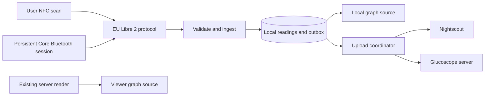

# iOS Libre 2 Bluetooth mode implementation plan

This document is both the implementation plan and the complete handoff for continuing the work. It was updated on 11 September 2026 with the user-owned v7/v8 isolated storage evidence, decoder commit `96b0d0b`, disconnected generation/commit ownership commit `3c18d19`, committed disconnected ordering/backlog and accepted-result candidate-adapter engineering scaffolding at `268af2d`, and the proposed [independent decoder-evidence procedure](ios-libre2-decoder-evidence.md) and [live-state/clock engineering policy](ios-libre2-live-state-clock-policy.md). The two policy documents are documentation only: they provide no qualification result, implementation or promoted runtime path. The original target architecture remains below; items which are not explicitly listed as implemented are planned and unimplemented.

## Start here for the next session

The current source connects the real BLE collector through `LibreTransportHandoff` → `LibreOrderedIngestion` → `LibreCandidateAdapter` and the guarded local store. `LibreCollectionCoordinator` now owns that composition; its former metadata-only worker has been removed. Completed frames enter the ordered queue before diagnostic delivery, and notification diagnostics retain metadata instead of packet hex. The production decoder remains closed: this path still saves **zero glucose readings**. The screen/export reports that saving is blocked by the unqualified decoder policy. The user has since clarified that the next work should save explicitly experimental local readings while keeping qualified production entry closed; that follow-up is not part of this runtime-wiring checkpoint.

The current runtime route passed a focused ordinary-source smoke test through composition → handoff → ordered queue → adapter → closed production decoder, including two ordered frames, coalesced coordinator status and synchronous stop revocation. The complete fourteen-executable portable regression passed with its expected corrupt-store Core Data 259 / SQLite 26 diagnostics. An unsigned Debug build for the iPhone 16 iOS 18.5 simulator succeeded under Xcode 26.2 with no Libre fixture flags; the only warning was the existing AppIntents metadata skip because the app has no AppIntents framework dependency. No app launch or device validation was performed for this revision. The [handoff contract](ios-libre2-transport-handoff.md) records the implemented routing and its limits. Nonpayload Bluetooth/status/error controls still use the existing event relay, so the handoff bounds do not cover every app event. Continue toward useful local readings without another isolated abstraction phase; retain the unresolved decoder and clock/freshness qualification boundaries.

The requested app experience is recorded in [the iOS Bluetooth/standalone app experience plan](ios-ble-app-experience-plan.md). The interview is partly complete: consult its confirmed answers and resume only the unresolved topics before UI implementation. Its multiple-upload-target direction and requirement to pause uploads in Viewer supersede the older single-target and continue-upload assumptions in this document. Supporting those decisions requires a separately reviewed persistence schema and worker design; no UI, schema or upload implementation is authorized yet.

The user reports that revision `268af2d` builds and runs successfully. No build log or diagnostic export was supplied, and no agent-run Xcode build was performed. This is user-owned compilation and launch evidence covering the committed disconnected ordered-ingestion and candidate-adapter source. It does not establish runtime candidate creation, canonical reading ingestion, transport handoff, production-store durability or decoder accuracy.

The two previously missing combined portable concurrency fixtures described in [the ingestion audit checklist](ios-libre2-ingestion-design.md#remaining-cross-boundary-audit-checklist) are now implemented. The full fourteen-executable regression, now including the ordinary runtime-route smoke, passed on 11 September 2026. These synthetic plumbing checks add no independent numerical-oracle evidence. The current source now wires the handoff into the app; experimental local saving is the next implementation step, while qualified decoder promotion and device runtime validation remain outstanding. Independent software-oracle work remains available as a separate evidence path. The evidence procedure and live-state/clock engineering policy are proposed and documented, but neither is qualified or implemented. Physical paired acquisition is currently unavailable, and no hardware action or additional reader/export information is requested for this comparison phase.

On 11 September 2026 the user reported that **Experimental glucose decoding v6 (frame ownership and metadata storage)** built, launched, and showed **Collection storage: open and waiting**. No build log or diagnostic export was supplied, and no agent-run Xcode build was performed. This is user-reported evidence that the v6 startup path opened the store. It supplies no evidence of an arriving frame, metadata-ready transition, locked-device protection, persistence across reopen or relaunch, or glucose accuracy.

The transactional foundation was committed as `30c1ffc`. The user reports that this foundation builds and launches without visible errors; no build log was supplied and no agent-run Xcode build was performed. That revision did not open the store, so the report is compilation and launch evidence only. Its four-executable regression suite passed on 10 September 2026.

V6 is committed as `8350127`; its transactional foundation remains commit `30c1ffc`. `LibreVerifiedFrame` captures CRC-valid payload bytes, receipt time, process sequence, transport generation and the exact pairing/calibration/clock snapshot. The shared generation gate invalidates queued callbacks on lifecycle changes, and the experimental decoder uses that captured snapshot. The app-owned `LibreCollectionCoordinator` opens dedicated reading storage at launch and prepares session metadata from current frames through `LibrePersistenceBridge`, with bounded work/retry and redacted main-actor status in the screen/export. It submits no diagnostic calculations, reading candidates or delivery records. Missing-clock restoration from canonical SQLite metadata exists as an explicit service seam with synthetic coverage; there is no repair UI or automatic repair. See [ios-libre2-ingestion-design.md](ios-libre2-ingestion-design.md) for the boundary and transaction contract.

1. The v7 source adds a deliberate storage-only runtime probe. It writes one synthetic session/clock metadata fixture to a separately isolated SQLite store, verifies that fixture with zero readings and zero delivery records after store reopen, records the actual SQLite/WAL/SHM protection attributes when those files exist, and requires a new app process before reporting relaunch persistence. It runs only from explicit screen actions and does no launch-time filesystem work. Its screen and export contain redacted summary results without fixture identifiers, paths, payloads or glucose values.
2. The two latest user-owned v7 exports, at 07:52:27 and 07:52:52 UTC on 11 September 2026, both report **Relaunch verified**, with metadata reopen and relaunch true and zero readings and deliveries. In both exports the retained SQLite, WAL and SHM files had `completeUntilFirstUserAuthentication` before the verification store opened and while it was open. Coordinator initialization at 07:52:12 and 07:52:42 UTC corroborates separate app launches. Both exports are later-process retained-metadata verifications, not the original first-save export; repeating the actions did not invalidate the bounded retained-state result. The iPhone ran iOS 18.7.8 and app `1.0.6 (1)`.
3. The saved collector was still **Connecting**, with Bluetooth powered on and zero raw or verified frames, rather than stopped as requested. The probe is isolated from BLE and production storage, so this does not invalidate its storage result, but it supplies no arriving-frame, sensor-takeover or two-collector coexistence evidence. The observed protection attributes were read in the foreground and do not establish locked-device or post-reboot accessibility, production reading transactions, delivery durability or decoder accuracy.
4. The v8 source adds a second, isolated locked-device probe. A deliberate foreground action obtains a bounded iOS background-task lease, then waits for direct observation of both background state and unavailable protected data. Only then does it make a fresh synthetic metadata save and verify read, close and reopen boundaries while rechecking those conditions. Cancellation, lease expiration, foreground return, protected-data return or no qualifying callback is reported as inconclusive. It has no NFC, BLE, sensor, reading, delivery or upload dependency and does no probe filesystem work at launch.
5. The first user-owned v8 report was exported at 13:06:44 UTC on 11 September 2026 from an iPhone on iOS 18.7.8 running app `1.0.6 (1)`. Collection was stopped, Bluetooth was powered on, production storage was open and waiting for current sensor metadata, frame counts were zero, and canonical ingestion remained disabled with zero candidates. After background entry at 12:52:44, all 14 evidence checkpoints at 12:52:54 directly observed both unavailable protected data and background state. A fresh synthetic metadata mutation survived save, read, close, reopen and retained read with zero readings and deliveries. The new isolated store had no files before its first open; after saving and again after reopening, its SQLite, WAL and SHM files all reported `completeUntilFirstUserAuthentication`. Foreground return at 13:06:33 and the later export do not turn the roughly 13-minute-49-second background interval into a continuous storage test: the bounded operation itself completed ten seconds after background entry. No repeat is needed for this result.
6. This v8 result establishes only the isolated synthetic metadata sequence while locked after first unlock on this phone and OS. It does not establish post-reboot-before-first-unlock access, production reading transactions, delivery durability, general background scheduling, relaunch persistence of the v8 in-memory verdict or decoder accuracy. The ordinary v7 metadata reopen/relaunch flags are false in this export because the locked action resets those separate foreground-probe flags; they do not invalidate the locked close/reopen evidence. The later engineering increments add separate production decode types, fixture-only slot evaluation, writer ownership, ordered-ingestion and a private candidate adapter. The normal decoder still rejects every otherwise valid frame as unqualified; the current app coordinator now instantiates the adapter without promoting that decoder. The proposed evidence procedure and live-state/clock policy are documented, but independent timestamp-matched numerical evidence and explicit lifecycle/status/clock-freshness qualification are still required. Complete production ingestion, normal graphs, backend delivery and NFC ingestion remain gated; no sensor action is requested for this work.

The user has now switched the sensor back to their known-working CGM reader. They performed two ordinary-use spot checks and report that the implementation value exactly matched the reference's preceding-minute value both times. These successful checks are bounded evidence: no numeric traces or timestamps were supplied, and the preceding-minute result was not shown to be the same sensor sample. The reference has no timestamped history export, and the user believes the sensor can pair to only one app; the pairing statement is their understanding of this setup, not a verified universal limitation. Physical paired acquisition is therefore currently unavailable, with no collector switch, simultaneous comparison, repeated spot check, NFC action or further reader/export detail requested for this comparison phase. The user previously used a second physical phone for their usual readings, switched the sensor between collectors, and later deliberately repeated development-app NFC setup to resume frames; those actions do not establish two-phone coexistence or takeover/recovery behavior. A future feasible evidence design can be reviewed without automatically promoting the decoder or waiving numerical, status or clock gates.

The connection diagnostic phase is implemented. The temporary home screen bypasses the existing viewer and polling UI and exposes NFC setup, BLE state, raw encrypted frames, decrypted CRC-valid payloads, logs, and diagnostic upload. On one non-Plus `7F` Libre 2, NFC identity and patch interrogation, the 344-byte FRAM read and lifecycle CRC validation, streaming enablement, `FDE3`/`F001`/`F002` discovery, counter-1 unlock, and repeated frame receipt all succeeded. Two foreground frames arrived 59 seconds apart. A later 5 minute 11 second locked-phone test received five more frames at 59–62 second intervals with no logged disconnect or additional unlock, bringing that session to eight raw and eight CRC-valid frames.

This does not establish general reconnect/restoration reliability, 72-hour reliability, or compatibility with `9D` and `C5` sensors. A pure decoder and transient experimental display have now been built and exercised by the user on one non-Plus `7F`; the later two exact preceding-minute spot matches add bounded numerical evidence without supplying a timestamp-matched same-sample dataset. The first two NFC attempts lost the tag during the initial `A1` patch query. Bounded read retries and same-tag reacquisition were then added; the later scan succeeded on its first read attempts, so there is no evidence that retries caused the success.

The exact physical evidence is from an iPhone on iOS 18.7.8 and app `1.0.6 (1)`. NFC patch information and all 344 FRAM bytes passed lifecycle CRC validation on the successful scan, followed by streaming enablement. BLE found the expected service and characteristics, reserved unlock counter 1 before sending it, and received two CRC-valid frames 59 seconds apart. During the locked-phone interval from 18:11:26 through 18:16:37 UTC, five frames arrived at 18:12:22, 18:13:24, 18:14:24, 18:15:23, and 18:16:23: intervals of 62, 60, 59, and 60 seconds. There were no logged disconnects, further unlock attempts, or CRC failures. Raw identifiers and payloads remain only in local exports.

A later v4 export at 20:19:01 UTC records one pending-connection recovery without NFC setup. The last frame before the gap arrived at 19:43:25, the Bluetooth connection timed out at 19:43:57, and the connection remained pending. It connected at 20:14:24, reserved counter 3 once after the previously recorded counter 2, and immediately resumed valid frames, followed by frames at 20:15:24, 20:16:24, 20:17:25, and 20:18:24. The observed valid-frame gap was 1,859 seconds (30 minutes 59 seconds); post-return intervals were 60, 60, 61, and 59 seconds, and all 16 recorded raw frames were CRC-valid. Reconnect frames contained their normal sparse earlier slots, including samples at 20:06:39 and 20:03:39 in the latest frame; this is limited recent recovery inside a transport frame, not recovery of every missing minute, and none was persisted. The user recalls being roughly 15 metres away behind several walls and returning near 22:15 Amsterdam time; the duration is unknown and may have been about 30 minutes. This is one recovery consistent with that range-loss test, but the log does not prove the cause. It does not establish repeated recovery or v5 clock behavior.

The four v5 exports from 20:26:22 through 20:28:58 UTC provide one successful persistent-clock sequence on the tested sensor. The baseline followed a rebuild and relaunch, restored the saved pair, reserved counter 4, and received three CRC-valid frames with next counter 5. The deliberate calibration scan validated FRAM, saved calibration at sensor minute 4386 and did not send streaming enablement; the clock remained at minute 4340 and 19:40:39, the counter remained 5, and the diagnostic result cleared pending a new frame. A CRC-valid frame arrived 50 seconds after calibration was saved and decoded all seven sparse slots. After another relaunch, calibration and clock were still present, counter 5 was reserved once so the next counter became 6, and a CRC-valid frame decoded all seven slots. Overlapping sensor minutes retained their timestamps across both recapture and relaunch. The newest sensor timestamps were 15, 16 and 15 seconds ahead of packet receipt in the three populated exports; the fixed mapping behaved consistently, but its absolute alignment still carries the original NFC minute-resolution and phone-clock uncertainty. This is one bounded success; it does not establish glucose accuracy, repeated clock reliability, migration and repair behavior for every stored-state case, or broader reconnect/restoration qualification.

## Current implementation and source map

| Area | Current implementation |
| --- | --- |
| App lifecycle | `GlucoScopeApp.swift` creates the app-owned diagnostics coordinator at launch. `LibreBluetoothCentral` uses a serial queue and restoration identifier. |
| NFC setup | `Sensor/Libre2/LibreNFCSession.swift` identifies supported revisions, reads/decrypts all FRAM, validates lifecycle CRCs, enables streaming, and implements bounded read retry/reacquisition. Setup is always a deliberate user NFC action. |
| Protocol | `Sensor/Libre2/Libre2Protocol.swift` contains sensor classification, authentication, decrypt, CRC and FRAM primitives. `LibreFrameAssembler.swift` bounds 46-byte frame assembly; the BLE central applies the fragment timeout. |
| Pairing state | `LibreSensorSession.swift` models pairing state. `LibreSessionStore.swift` stores it in Keychain; the BLE central persists each unlock counter reservation before use. Versioned calibration and a separate session-stable `LibreSensorClockAnchor` are persisted; legacy records retain pairing and seed an absent anchor from valid calibration. Physical identity excludes mutable patch bytes 4–5, while the full paired patch remains unchanged for BLE authentication. Full FRAM is discarded. Versioned `persistenceSessionID`, save-before-use legacy migration and stable fingerprint helpers are now implemented; malformed present identity blocks ingestion without destroying pairing. Deliberate same-wear setup preserves both UUID and original clock only with coherent evidence, otherwise requiring repair; different physical sensors get new UUIDs. These new identity paths remain hardware-unverified. |
| BLE | `LibreBluetoothCentral.swift` retrieves a known peripheral or performs exact-name foreground discovery, discovers `FDE3`/`F001`/`F002`, subscribes, unlocks, validates frames, keeps connection requests pending, and has preliminary restoration/reconnect handling. |
| Experimental decode | `Libre2DiagnosticDecoder.swift` independently parses CRC-valid payloads using sensor-owned calibration. In v6 the decoder uses the exact captured frame session, and the diagnostics screen retains only the latest transient frame result, including rejected slots; values are not canonical readings and are not saved, graphed or uploaded. |
| Production decoder boundary | `Libre2ProductionDecoder.swift` adds immutable ownership comparison, whole-frame rejection, canonical-clock validation and restricted result types. The normal `decode` entry point produces zero accepted slots for every policy/revision. The portable-fixture-only engineering entry point checks seven sparse slots using unrounded `20...600` mg/dL, one ties-away integer conversion and per-slot rejection. `LibreCandidateAdapter.swift` now implements the private same-invocation frame/preparation/decode/map/guarded-write boundary and adversarial fixture-only seams. The app coordinator now instantiates it, with no diagnostic conversion or qualified policy; the normal source shape cannot create ingestible candidates. |
| Diagnostics | `LibreDiagnosticsCoordinator.swift`, `LibreDiagnosticsView.swift`, and `LibreDiagnosticsUploader.swift` drive the temporary home screen and local diagnostic uploads. `AppView.swift` currently routes directly to this screen. V6 adds redacted storage state, operation/time, process sequence and canonical-ingestion-disabled status. V7 adds explicit foreground probe actions and redacted protection/reopen/relaunch results. V8 adds explicit arm/cancel controls, protected-data/lifecycle observation and redacted locked-attempt evidence. |
| Persistence and coordination | `Persistence/ReadingStoreTypes.swift`, `ReadingStoreModel.swift`, `ReadingCommitAdmission.swift`, and `ReadingStore.swift` provide Core Data transactions, fault handling and a guarded writer entry point. `LibreVerifiedFrame.swift` owns a private revocable commit epoch per transport activation and issues opaque admissions bound to one current frame and canonical session. `ReadingStore` now rejects terminal-to-active lifecycle regression at metadata resolution and guarded save. `LibrePersistenceBridge.prepareCandidates` performs read-only per-frame preparation and advances only the proposed last-observed date; candidate metadata changes remain inside the guarded reading transaction. `LibreOrderedIngestion.swift` implements the eight-frame/drop-newest FIFO, monotonic residence checks, single worker, failure flush/pause and bounded recovery/refetch policy. The app-owned `LibreCollectionCoordinator` now composes the adapter and queue, and BLE feeds them through `LibreTransportHandoff`. The former metadata-only worker is removed; the closed decoder still yields zero candidates. `LibreStorageProbe` remains isolated from readings. |
| Tests | `ios/Libre2Tests/` contains synthetic authentication, FRAM, decrypt/CRC, frame assembly, classification, counter, NFC retry, persistent-clock migration/repair, numerical decoder, transaction, ownership, ordered-mailbox and candidate-adapter fixtures. The runner compiles ordinary/fixture decoder and adapter source shapes separately; fixture flags remain absent from the app target. The full thirteen-run regression including the combined fixtures passed on 11 September 2026. Portable fixtures cannot claim iOS locked access, UIKit/Core Bluetooth runtime ordering or clinical accuracy. |

## Next phase: calibrated readings and durable ingestion

Steps 1–2 below are implemented in source: `LibreCalibration.swift`, safe session migration, initial setup capture, and the deliberate read-only calibration action. The action merges into the latest BLE-owned session without resetting its counter, peripheral, collection state or frame counts. The user-run v3 export at 18:37:13 UTC on 10 September 2026 confirms identity-checked read-only calibration capture and save on the same non-Plus `7F`, with no streaming-enable command, stop or reconnect during the capture. Calibration reports format 1, sensor minute 4277 and lifecycle 3. Step 3 now has a pure decoder and diagnostics-only presentation exercised in the user-built app. Its numerical output still requires independent timestamp-matched comparison. Step 4 includes the committed `30c1ffc` transaction foundation, the committed v6 metadata-only runtime coordinator, v7 foreground storage evidence, and the first successful v8 locked-device isolated metadata result; canonical reading ingestion remains unimplemented. The user reported on 11 September that v6 built, launched and opened the store in its waiting state. All seven portable executables, including the v8 control-flow fixtures, passed on 11 September 2026. Two later-process v7 device exports verify retained synthetic metadata after reopen and relaunch, with zero readings/deliveries and expected foreground protection attributes on SQLite/WAL/SHM both before and while open. The v8 device export verifies a fresh synthetic metadata mutation/read/close/reopen sequence with unavailable protected data in the background and the expected protection class on all created store files. Production-store locked durability and post-reboot-before-first-unlock access remain untested. Corrected mutable-word recapture now passes; upgrade migration from a legacy paired installation remains unverified on hardware. See `libre2-ble-testing.md` for the device evidence and remaining boundaries.

The v3 report was exported 13 seconds after foreground BLE discovery began, with Bluetooth powered on, zero frames and no connection error. A preceding v2 report shows a deliberate full setup at 18:36:37–38, after 28 CRC-valid frames, resetting the next counter to 1 and clearing the discovered peripheral. The v3 capture preserved that latest identity and counter-1 state; it cannot establish preservation of the older connected pairing state. This brief discovery snapshot does not establish BLE failure.

A subsequent same-sensor scan exposed that patch bytes 4–5 changed after streaming enablement even though the UID and every stable patch byte matched. Exact patch equality incorrectly rejected that scan. Corrected source treats those bytes as mutable operation material: the current query supplies them for FRAM decryption, calibration ownership uses the remaining stable identity, and saved pairing credentials retain their original full patch. The corrected path later saved two read-only captures from that same streaming sensor while preserving the paired patch, peripheral and counter. The first was followed by a CRC-valid frame six seconds later without streaming enablement, reconnect, disconnect or another unlock. The second export was only ten seconds after saving, so it does not establish post-capture frame continuation by itself.

The user-run v4 export then recorded one actual Core Bluetooth `willRestoreState` callback retrieving the saved peripheral and calibration without NFC setup. It reserved counter 2 once and received three raw and three CRC-valid frames over 112 seconds. The decoder accepted 7/7, 7/7 and 6/7 sparse slots; the final 15-minute slot was rejected for zero raw glucose. Sensor-anchored newest-sample timestamps lagged packet receipt by 8, 2 and 0 seconds. No errors or disconnects were logged. This proves one restoration callback and an operating diagnostic decoder on the tested sensor. The later two exact preceding-minute spot matches are retained separately as bounded value evidence; no timestamped same-sample comparison is available.

In the user-built v4 behavior, both corrected recaptures reported the same sensor minute but occurred 22 seconds apart. Recomputing the timestamp anchor from each capture shifted the inferred sensor-start time by 22 seconds; the first corrected anchor was also 6 seconds earlier than the prior saved anchor. The stable-clock v5 increment persists the first valid sensor-minute/date mapping separately from changing calibration metadata. The user-built v5 retained that mapping through one recapture, its following frame and one relaunch. Legacy records with valid calibration seed a missing field once; a present malformed/null anchor remains unavailable rather than silently reanchoring. The portable migration fixtures pass; device evidence remains limited to the ordinary valid legacy-anchor path.

The later source review aligned clock-anchor construction, decoding and persisted-session recovery on the same 20,880-minute supported lifetime. An out-of-lifetime stored anchor becomes unavailable so a deliberate valid calibration recapture can repair it without replacing pairing state; boundary, malformed, null and foreign-anchor fixtures were expanded and pass in the portable suite. The device sequence exercised an ordinary valid retained anchor, not these boundary and repair cases.

This increment also hardens calibration FRAM capture for a sliced `Data` input whose indices do not start at zero, with a synthetic regression fixture. It does not change the diagnostic equation, numeric bounds or canonical-ingestion status.

The disconnected production-decoder increment is now implemented in `Libre2ProductionDecoder.swift`. Policy `libre2-production-engineering-policy-v1` and decoder `libre2-nonlinear-production-v1` have no qualified revision: normal decoding returns a redacted whole-frame rejection and zero slots. `LIBRE2_ENGINEERING_DECODER_FIXTURES` exposes a separate engineering evaluation type only to portable fixtures; the app target does not define it. Its unrounded `20...600` mg/dL domain, nearest-integer ties-away rounding and `engineeringChecksPassed-v1` quality remain unqualified engineering policy. That increment retained the separate diagnostic `1...1000` Double domain and v8 screen revision; the current export identifies v9 runtime ordered ingestion. The expanded `./ios/Libre2Tests/run.sh` passed all nine executable runs on 11 September 2026, including both the normal closed-gate build and the separately flagged engineering build. Shell syntax and whitespace checks passed; the existing corrupt-store fixtures emitted their expected Core Data diagnostics.

The user reports that disconnected production-decoder commit `96b0d0b` builds and launches successfully; no build log or diagnostic export was supplied, and no agent-run Xcode build was performed. The user separately reports that revision `3c18d19` (HEAD when reported), which adds the ownership source, builds and runs successfully under the same evidence boundary. The ownership increment couples generation revocation to the writer's synchronous save decision through a private per-activation epoch and opaque frame-bound admission. At that revision it had no runtime caller and did not promote the decoder; its qualification blockers remained in place. The current app wiring does not itself supply that qualification. Its ten-run portable suite passed on 11 September 2026; the later disconnected scaffolding expands that suite to thirteen passing runs as described below.

The disconnected source phase committed at `268af2d` implements proposed policy `libre2-ordered-ingestion-v1`: transport-side admission before asynchronous handoff; at most eight retained frames including active work; drop-newest overflow; 120 seconds of monotonic pre-submission residence; and one worker preserving increasing process sequence while allowing holes. It also implements read-only per-frame metadata preparation, terminal-lifecycle enforcement, the private accepted-result adapter and guarded-writer binding described above. The residence limit bounds engineering backlog age; it does not qualify sensor-clock or glucose freshness. At that revision the app target compiled the ordinary source shape without fixture flags, but no app service instantiated or fed the path. All production decoder policies remain closed, so normal decoding produces no canonical candidate. The current fixture increment adds all three concurrent offer/invalidation orderings and queue-to-adapter-to-guarded-store reversed-minute/conflict coverage. After bounded waits were added, the full thirteen-run regression passed on 11 September 2026 with no warnings or failures; the corrupt-store Core Data 259 / SQLite 26 diagnostics were expected. Fixture-only queue hooks are compiled out of the ordinary app source shape. [The decoder contract](ios-libre2-decoder-contract.md), [ingestion design](ios-libre2-ingestion-design.md), [evidence procedure](ios-libre2-decoder-evidence.md), and [live-state/clock policy](ios-libre2-live-state-clock-policy.md) own the detailed rules. The later handoff component and current runtime wiring are described at the top of this document; decoder promotion remains unresolved. No sensor action is requested. Agents may run Xcode compilation checks; the user owns app and device execution.

Preserve the working NFC/BLE path while implementing these steps:

1. Extract calibration data from validated NFC FRAM and persist it with the sensor session. Migrate the existing Keychain `LibreSensorSession` schema safely: its current Codable records have no calibration fields. Decode old records without deleting them, report a needs-calibration state, and preserve the peripheral ID, unlock code, and next reserved counter.
2. Acquire missing calibration through a deliberate, identity-checked, read-only NFC capture. It must not automatically send the `A1/1E` streaming-enable command, reset pairing, or replace the sensor. Never initiate NFC without the user.
3. Build a pure, independent decoder that accepts calibration plus a CRC-valid BLE payload. Validate sensor lifecycle/minute, sparse offsets, raw field ranges, temperature/adjustment inputs, and zero or otherwise invalid raw slots before producing values. Preserve the BLE sample offsets `0, 2, 4, 6, 7, 12, 15` minutes and derive timestamps from the sensor-minute anchor rather than packet receipt time.
4. Keep proof calculations isolated to diagnostics and fixtures while the new transaction foundation is verified and the production decoder/coordinator contracts are implemented. Once values become canonical app readings, commit each accepted reading through the transactional local store before displaying it, graphing it, or scheduling upload. Deduplicate sparse/repeated frames by sensor session and sample position. Normal graph integration and durable Nightscout/Glucoscope upload remain later work.

Continue through bounded, reviewable iterations and request physical sensor tests when useful. Do not ask for routine permission, change sensors, or perform another streaming setup automatically.

Before starting work, announce the next bounded step. Delegate bounded implementation and review work to child agents with independent tasks and clear file ownership; choose Sol or Astra and an appropriate effort level for each task. The root agent reviews and integrates their work and performs static checks. After each bounded phase passes its appropriate checks and review, commit that phase before editing the next one; delegate the routine commit to an inexpensive Sol agent. Stage only the reviewed phase paths, and exclude `docs/xdripswift`, private diagnostic exports, raw identifiers and packet payloads. The user has authorized agents to run the portable regression suite and Xcode compilation checks without asking again. App launch and physical-device execution remain user-owned. Stop or interrupt each worker immediately when its assigned work completes. Do not maintain an idle worker pool.

## Development and diagnostics environment

The local receiver is intentionally left running in tmux session `GlucoScope`, window `1`, pane `%52`:

```sh
python3 -u scripts/diagnostics_server.py --host 0.0.0.0 --port 8765
```

Its endpoint is `http://10.0.0.22:8765/diagnostics`; `GET /health` checks reachability. It accepts UTF-8 `text/plain` POST bodies up to 1 MiB and returns HTTP 201 with the saved filename. Files are mode `0600` under `/tmp/glucoscope-diagnostics`; this temporary directory is not durable storage. The app automatically pushes a snapshot after an NFC result and offers **Send diagnostics** for later BLE state; therefore the automatic NFC upload may pre-date discovery and frames. Find reports by modification time, not lexical filename ordering. Do not commit exported logs, raw identifiers, or packet payloads. The receiver URL is editable, and the current numeric IP has a specific ATS exception which must be updated if the address changes.

`docs/xdripswift` is an untracked local reference checkout. Keep it out of commits and app/runtime dependencies. It reports commit `53b3d6bf1b550c99b19c3d5d2c2f80dd226465d8`; `docs/libre2-eu-protocol.md` records SHA-256 hashes for every inspected file and the supplied GPL-3.0 license. The implementation is independently written, and that is not a legal-clearance claim.

Agents may run the portable regression suite and the Xcode compilation commands below. App launch and physical-device execution remain user-owned:

```sh
./ios/Libre2Tests/run.sh
xcodebuild -project ios/GlucoScope.xcodeproj -scheme GlucoScope -configuration Debug -sdk iphonesimulator -destination 'generic/platform=iOS Simulator' CODE_SIGN_IDENTITY=- build
xcodebuild -project ios/GlucoScope.xcodeproj -scheme GlucoScope -configuration Debug -sdk iphoneos -destination 'generic/platform=iOS' CODE_SIGNING_ALLOWED=NO build
```

Xcode 26.2 simulator and generic iPhone compilation passed for the earlier connection revision, with only existing warnings. The device exports show that the user built and launched v5, and `./ios/Libre2Tests/run.sh` passed on 10 September 2026. For the foundation committed as `30c1ffc`, the user reports a build and launch without visible errors. No build log was supplied and no agent-run Xcode build was performed; that revision did not open the store. The four-executable synthetic suite passed on 10 September 2026. V6 adds metadata-only runtime opening and coordination; its final six-executable suite passed on 10 September 2026, and the user reported a successful build, launch and open/waiting store state on 11 September. No logs were supplied. The user reports that revision `268af2d` builds and runs successfully; no build log or diagnostic export was supplied, and no agent-run Xcode build was performed. This report covers the committed disconnected ordered-ingestion and candidate-adapter source but does not supply runtime-path or accuracy evidence. Use normal ad-hoc signing for simulator launches: a wholly unsigned simulator app produced Keychain error -34018, resolved by signing. Local device testing needs normal development signing with the NFC Tag Reading capability/profile. The deployment target remains iOS 16.4 and the tested build reports app version `1.0.6 (1)`.

## Planned target architecture

Implement an independent, offline-capable Libre 2 collector alongside the existing viewer. Bluetooth setup, live values, graphing and retained history must work fully on device without an account, server or credentials. Commit every valid reading to local storage before displaying it or attempting an optional upload; the local reading is the source of truth. Keep sensor collection, graph presentation, and backend delivery separate so network failures cannot interrupt BLE collection.

**Scope and working assumptions**

- iOS client only, retaining the current iOS 16.4 app deployment target. Use Core Data rather than requiring iOS 17 for SwiftData. Android remains outside this work; the Rust server changes below are required to accept uploads.
- One active EU FreeStyle Libre 2 sensor. A single Nightscout or Glucoscope upload destination may be configured, but is optional.
- Target EU Libre 2 revisions identified in the reference as `9D`, `C5`, and the non-Plus `7F` variant. Validate each on hardware before claiming support. Exclude Libre 1, Libre 2 US, Libre 2 Plus, and Libre 3. Reject incomplete or unknown patch information explicitly.
- Start with an already activated sensor. Enabling BLE streaming is part of setup; starting a new sensor's wear period, resetting it, or extending its lifetime is outside this first release.
- Decode glucose locally using sensor-specific calibration information. Collection and decoding must work without LibreLinkUp or an external algorithm service.
- Existing installations remain in Viewer mode after upgrading. Bluetooth mode can run indefinitely with no upload destination.

**Important findings from the reference**

| Finding | Consequence for Glucoscope |
| --- | --- |
| `CGMLibre2Transmitter.startScanning()` starts an NFC session; `LibreNFC` reads identity, patch information and memory, then enables BLE streaming. | Initial pairing needs an NFC-capable iPhone and a deliberate sensor scan. A Bluetooth device picker alone is insufficient. |
| The BLE service is `FDE3`, with `F001` for writes and `F002` for notifications. Frames are 46 encrypted bytes and use a streaming unlock exchange. | Build a sensor-specific protocol implementation, including decryption and integrity checks. |
| The actual BLE parser reads seven measurements at offsets 0, 2, 4, 6, 7, 12 and 15 minutes. Some nearby comments describe older behavior. | Reconnecting can recover a sparse recent window, not hours of minute-by-minute history. Validate packet behavior rather than reproducing comments. |
| The NFC parser handles 16 recent trend slots and 32 history slots spaced 15 minutes apart. | Provide NFC backfill for approximately eight hours, subject to sensor age and valid stored slots. |
| Newer non-Plus `7F` sensors use a MAC-derived advertised name, unlike the older `ABBOTT` plus serial naming. | Store the identity returned by NFC; do not assume all EU sensors share a name format. Core Bluetooth still uses its own peripheral UUID. |
| The direct Libre 2 NFC callback in the reference extracts calibration parameters; the general FRAM parser contains history decoding. | Wire NFC history into our common ingestion pipeline explicitly; copying the connection flow would not by itself implement backfill. |

These protocol observations originated in the supplied source; the connection subset described above has since been exercised on one physical non-Plus `7F` sensor. In particular, **“backfill with a Bluetooth scan” means reconnect and recover whatever recent samples the BLE frames expose**. For a longer gap, the UI must offer **“Scan sensor for history (NFC)”**. There is no demonstrated arbitrary BLE history-download command in this reference.

**1. Establish an independent protocol specification and hardware proof**

Before building the full settings flow, create `docs/libre2-eu-protocol.md` and a small diagnostic harness with these deliverables:

- Record the reference snapshot identity/checksums, relevant files, observed field layouts, byte ordering, CRC rules, streaming unlock inputs, counter behavior, and sensor classification rules.
- Describe the calibration extraction and temperature conversion mathematically, including the provenance of constants and lookup data. These are part of the decoding work, not optional polish.
- Implement new Swift types from that specification. Do not copy xDrip files, class hierarchies, utility bodies, or tables wholesale. Preserve source references for each derived behavior; record the supplied GPL-3.0 license without treating a rewrite as a legal clearance claim.
- Capture our own permitted NFC/BLE test fixtures. Keep xDrip outside the app target and runtime dependencies. Use reference outputs as a comparison oracle during development, with the selected xDrip algorithm configuration recorded.
- Prove NFC identity/calibration reads, BLE streaming enablement, notification subscription, unlock and repeated valid frame decoding on real EU sensors. Resolve whether a fresh activation workflow is necessary separately from streaming setup.
- Check coexistence with the official Libre app and other collectors. The reference warns about scanning with LibreLink after pairing; verify takeover behavior and give concrete recovery guidance during setup.

Exit criteria: a repeatable connection to a supported sensor, verified locally calculated glucose, and an initial locked-screen/background run. Treat unavailable calibration data, unexplained decoding differences, and unverified sensor revisions as explicit release blockers. Establish conversion tolerances before fixture acceptance; matching xDrip alone does not prove agreement with the official sensor algorithm.

**2. Introduce the collector architecture and persistent data model**



Create an app-owned `CollectionCoordinator`, independent of SwiftUI view lifetimes. It owns `LibreNFCSession`, `LibreBluetoothCentral`, a pure Swift `Libre2EUProtocol`, and a transactional `ReadingStore`. A separate `UploadCoordinator` consumes the persisted outbox. Present published status on the main actor; serialize Core Bluetooth operations on a dedicated queue and database writes through a single writer.

Keep the existing `DataSource` protocol for graph queries. Add `LocalSensorDataSource`; make `RealtimeDataService` observe local commits in Bluetooth mode and retain server polling in Viewer mode. Do not implement BLE as a repeating network-style fetch. Introduce an `AppMode` preference rather than conflating operating mode with backend type.

| Persistent entity | Required information |
| --- | --- |
| Sensor session | Stable session ID, UID, patch information/revision, expected BLE identity, peripheral UUID, calibration version/data, sensor-age clock anchor, lifecycle state and streaming setup state. |
| Reading | Stable ID, sensor session, sensor minute, sample kind/resolution, captured UTC timestamp, received timestamp, canonical glucose in mg/dL, quality, origin (`bleLive`, `bleHistory`, `nfcTrend`, `nfcHistory`) and decoder version. |
| Upload destination | Stable destination ID, backend kind, normalized URL, credential reference, configuration revision and enabled state. |
| Outbox item | Reading ID, destination ID, immutable payload/version, status, attempt count, next eligible attempt, last error, background task/batch identity and acknowledgement time. |

Use unique constraints and one transaction to save the reading and its required delivery-state row; the destination is optional. With no destination, `unassigned` means intentionally local-only and must not appear as a delivery error or blocked setup. If the user later selects a destination, enqueue eligible readings transactionally. Persist the sensor minute and establish a stable UTC anchor; never timestamp recovered samples as if they were newly measured. Test phone clock corrections, restart, timezone changes, sensor replacement and counter rollover.

Deduplicate by sensor session and sample position/kind. BLE and NFC trend records for the same minute represent one canonical trend reading; keep coarse NFC history distinct internally. For graph/upload overlap, prefer an actual trend measurement over a history sample at the same timestamp. Freeze an upload payload once dispatched; later recovered history must not silently rewrite an acknowledged live reading. Preserve meaningful gaps instead of manufacturing samples by interpolation.

Retain full-resolution local history indefinitely by default when space is available. Use one year of minute-resolution readings as a capacity-planning benchmark, not a retention limit. A future purge action must be initiated deliberately by the user and show its date range, record count and affected delivery scope before deletion. It must not silently delete assigned pending/unacknowledged uploads, alter frozen payloads, or change deduplication and sensor-session identity. A full disk is an explicit storage failure and must never trigger automatic deletion. Use protected local storage that remains accessible while locked after first unlock, including database sidecar and upload files. Store optional credentials and sensitive pairing material in Keychain with compatible accessibility. Report storage failures explicitly; a reading is not safely stored until its transaction commits.

**3. Make continuous BLE collection the core reliability feature**

Maintain one long-lived `CBCentralManager` with a stable restoration identifier and implement `centralManager(_:willRestoreState:)`. Initialize the coordinator at process launch using an app delegate bridge, including background launches, rather than waiting for a screen to appear. Restore peripheral delegates, discovered characteristics, subscriptions and pending connection state before initiating new work. Apple's [Core Bluetooth background guide](https://developer.apple.com/library/archive/documentation/NetworkingInternetWeb/Conceptual/CoreBluetooth_concepts/CoreBluetoothBackgroundProcessingForIOSApps/PerformingTasksWhileYourAppIsInTheBackground.html) describes this lifecycle.

Use an explicit state machine:

`disabled → needsSetup → waitingForBluetooth → discovering → connecting → subscribing → unlocking → streaming`

Handle recoverable disconnects through `reconnecting`; expose distinct permission, sensor-state and repair-required conditions. Treat “connected” and “receiving valid readings” as different statuses.

- Restore/retrieve the known peripheral first and keep an OS-managed connection request pending when it is out of range. Avoid repeatedly cancelling a healthy pending connection.
- Perform first discovery in the foreground immediately after NFC setup. The reference uses an unfiltered scan for Libre 2. Verify whether each revision advertises `FDE3`; do not assume a discoverable GATT service is advertised or that name-based discovery works in the background.
- Subscribe to the expected characteristic and perform the verified unlock sequence. Persist counter reservations before sending commands; serialize attempts so crashes and duplicate callbacks cannot reuse authentication state incorrectly. Define repair behavior for partial NFC enablement and counter exhaustion.
- Frame notifications with strict size bounds, fragment timeout, overflow handling and a fresh buffer per connection generation. Decrypt and verify CRC before parsing. Validate sensor age/state, calibration ownership and numeric results before persistence or upload.
- Track time since the last valid frame. Use event-driven checks and foreground/delegate opportunities to detect a stalled stream; foreground timers may assist but cannot be the background recovery mechanism. Reconnect with bounded recovery attempts and avoid radio-intensive loops.
- Keep callback work short: decode, persist and schedule delivery. Never wait for backend HTTP requests on the BLE queue.
- Add `bluetooth-central`, `NSBluetoothAlwaysUsageDescription`, NFC usage description and the NFC Tag Reading capability/`TAG` entitlement. Check the runtime NFC capability before setup. See Apple's [NFC entitlement documentation](https://developer.apple.com/documentation/bundleresources/entitlements/com.apple.developer.nfc.readersession.formats).

iOS cannot guarantee uninterrupted collection after the user force-quits the app; restoration also depends on pending Bluetooth work and device state. After reboot, protected state is unavailable until first unlock. Explain these concrete recovery cases in the collector UI and test them on supported iOS versions; see Apple's [restoration conditions](https://developer.apple.com/library/archive/qa/qa1962/_index.html). Do not use audio, location, or frequent background-fetch timers to keep the process alive.

**4. Implement recent BLE recovery and longer NFC backfill**

Provide separate actions with truthful labels:

- **Reconnect / recover recent readings:** retrieve or discover the paired sensor if disconnected, authenticate, then ingest the actual historical slots in arriving BLE frames. If already streaming, keep the connection and process incoming history; do not disconnect merely to “scan.” Show how many missing samples were recovered and which gaps remain.
- **Scan sensor for history (NFC):** read and decrypt the 344-byte FRAM image, validate its sections, then decode trend/history rings using their cursor positions and sensor-age timestamps. Handle the history publication delay and ring wrap described in the reference. Import all valid missing readings through the same transaction/outbox path.

A history-only NFC read should preserve streaming credentials and the existing BLE session where the verified protocol permits. Make streaming re-enablement an explicit repair/setup operation, because it can change connection state. Reject scans of another sensor during backfill; route sensor replacement through setup while retaining the old session and pending uploads.

Do not promise full minute-resolution recovery across a long outage: NFC history is coarser, and readings older than the available ring buffer may be unrecoverable. Separately, readings already stored on the phone survive an arbitrarily longer network outage, subject to available storage.

**5. Build durable delivery to both backends**

Create a `GlucoseUploadDestination` abstraction with Nightscout and Glucoscope adapters. Allow only one worker to claim a batch. Use at-least-once transport with idempotent server writes and deterministic payloads; an HTTP request being sent is not an acknowledgement.

- Drain eligible items after local commits, foreground launch, usable-network changes and transfer completion. Persist retries with exponential backoff and jitter; honor `Retry-After` for throttling. Network callbacks are opportunities to run, not a guarantee of background execution.
- Use a background `URLSession` with persisted file-backed upload batches, stable identifiers and delegate completion handling. Reconcile OS tasks with stored batch state on relaunch before reclaiming work. Coordinate any foreground fast path through the same batch ownership so it cannot race background delivery. Apple's [background transfer documentation](https://developer.apple.com/documentation/foundation/downloading-files-in-the-background) specifies file-backed uploads and relaunch handling.
- Commit acknowledgement only after the adapter validates HTTP status and the response's acceptance semantics. Recover correctly when the server committed but the response was lost, or the app terminated before saving the acknowledgement.
- Pause a destination on authentication failure and retain all data. Quarantine invalid records for inspection while allowing valid records through. Handle partial acceptance, oversized batches and server errors without deleting queued readings.
- Tie delivery state to destination identity. Changing credentials for the same destination preserves its queue. Changing server URL creates a new destination; offer an explicit pending-reading transfer choice rather than silently sending old data to another server.

For **Nightscout**, post SGV batches to `/api/v1/entries` using integer mg/dL, epoch milliseconds, ISO timestamps, `type: sgv` and a stable device label. Support explicit API-secret and access-token credential types; verify write permission rather than treating a successful status read as an upload test. Derive a trend direction only from sufficient valid recent data. See the [Nightscout API specification](https://github.com/nightscout/cgm-remote-monitor/blob/master/lib/server/swagger.yaml).

Verify duplicate behavior on the supported Nightscout releases. Current upstream [entry storage](https://github.com/nightscout/cgm-remote-monitor/blob/master/lib/server/entries.js) upserts typed entries by timestamp and type; keep timestamps/payloads stable across retries and test accepted-but-response-lost scenarios. Do not assume that an arbitrary client UUID or idempotency header provides deduplication across all deployed versions. Document compatibility with another uploader targeting the same timestamps.

For **Glucoscope**, add authenticated `POST /api/s1/entries` to the Rust server. Specify bounded batches containing `reading_id`, session/source identity, time in epoch seconds, and value in mmol/L to match the existing read contract. Return accepted IDs only after successful database writes. Define deterministic Influx point identity so retries overwrite the same point; do not add a fresh receipt timestamp to the identity. Include a contract test for retry after partial persistence.

The server also needs an upload-only operating configuration: LibreLink credentials become conditional, and `main.rs` must start the HTTP server without requiring successful LibreLink authentication. Add an explicit ingestion-source setting so the cloud poller does not concurrently overwrite or duplicate BLE uploads. Preserve the existing viewer response schema, with source-aware queries if storage tags change. Require configured authorization for the new write route even where legacy reads are public, and redact configuration secrets from logging.

**6. Add the mode switch and collector status**

This is a historical architecture sketch. The confirmed app-experience plan owns navigation, setup/reconnection behavior, multiple upload targets and mode-switch behavior where this section differs.

Place a segmented **Viewer / Bluetooth** control at the top of Settings → Connection. Extend onboarding with the same choice.

| Mode or action | Behavior |
| --- | --- |
| Viewer | Existing server configuration and polling; BLE collection disabled. Preserve prior sensor setup and local readings. |
| Bluetooth | Show local readings and retained graph/history immediately, sensor setup/status and last valid reading. Show upload status only when a destination is configured. |
| First Bluetooth setup | Check Bluetooth/NFC availability, scan the sensor and establish BLE collection. Finish setup without requesting server credentials; configure optional upload destinations separately according to the app-experience plan. |
| Switch to Viewer | Persist the new mode, stop reconnection/scanning and disconnect deliberately, and pause standalone uploads. Warn about pending uploads; an already in-flight request may finish and record its outcome, but start no further upload request or retry in Viewer. Preserve queued work for later resumption. |
| Switch back to Bluetooth | Resume the saved session without another NFC scan when its credentials remain usable. |
| Remove/replace sensor | Retain old readings and outbox items; clear only the applicable pairing state and set up a new session. |

Preserve viewer and upload configurations separately, even if initially seeded from the same server address. Server read credentials may lack write permission. Move credentials out of preference JSON and remove full-configuration logs during migration.

Fix relevant existing integration issues: cancel obsolete polling/in-flight fetches on mode changes, ignore late results from the previous source, handle a nil data source, and measure freshness from the latest reading timestamp rather than `Date()` at fetch completion. Local graph aggregation must retain gaps and must not be the upload source. Avoid mixing viewer data from a potentially different person into the local sensor graph.

**7. Deliver in reviewable milestones**

| Milestone | Main files/areas | Completion gate |
| --- | --- | --- |
| A. Protocol and hardware proof (partial) | Protocol specification, synthetic fixtures, diagnostic screen; `Sensor/Libre2/` | Connection, a short background run and experimental decoding pass on one `7F`; independent value verification and other revisions remain. |
| B. Local collection foundation (runtime routing implemented; decoder closed) | `Persistence/`, `Sensor/`, `Service/LibreCollectionCoordinator.swift`, `Service/LibrePersistenceBridge.swift`, `Service/LibreOrderedIngestion.swift`, `Service/LibreCandidateAdapter.swift`, `Service/LibreStorageProbe.swift`; future `Data/LocalSensorDataSource.swift` | Foundation `30c1ffc` has a user build/launch report and passed four-executable tests. V6 (`8350127`) adds metadata-only runtime opening and frame ownership; its six-executable suite passed on 10 September 2026, and the user reported open/waiting after build and launch on 11 September. V7/v8 provide the bounded isolated device storage evidence above. Commit `268af2d` includes the disconnected ordered mailbox, read-only candidate preparation, terminal-lifecycle enforcement and private accepted-result adapter; the user reports that this revision builds and runs without supplying logs or exports. The full thirteen-run regression including the current combined fixture additions passed on 11 September 2026. Production-store locked durability, post-reboot access, promoted decoder, runtime canonical ingestion and offline graphs remain unverified. |
| C. BLE lifecycle (partial) | `GlucoScopeApp.swift`, sensor services, `Resources/Info.plist`, entitlements and Xcode project | Five frames passed during one short locked-screen test, one `willRestoreState` launch succeeded, and one pending connection recovered after a gap consistent with range loss; repeated restoration and recovery tests remain. |
| D. Upload pipeline (planned) | New `Upload/`; `backend/src/webserver.rs`, `measurement.rs`, `database.rs`, `application_settings.rs`, `main.rs` | Offline queue drains to either backend with no lost or duplicate canonical samples under retry tests. |
| E. Backfill and settings (planned) | NFC decoder, `Preferences/`, `View/Configuration/ConnectionSettingsView.swift`, onboarding, `AppView.swift`, `RealtimeDataService.swift` | Both recovery actions, mode migration and source-switch tests pass. |
| F. Hardware qualification (planned) | iOS test target, backend integration tests, support matrix and release notes | Multi-day reliability and per-revision decoding evidence recorded. |

Keep decoding correctness and BLE restoration ahead of UI polish. Estimate the remaining work after milestone A: protocol/calibration verification and actual sensor availability are the largest uncertainties.

**Validation and release criteria**

- Protocol tests cover encrypted frames, CRC errors, arbitrary fragment boundaries, truncated/oversized data, wrong sensor identity, sparse offsets, NFC ring wrap, warmup/expired/error states and malformed calibration data. Verify values, units and timestamps against independently recorded expected results. Do not reject a valid steady glucose sequence solely because values repeat.
- Persistence tests inject termination between reading/outbox writes, before network scheduling, during transfer and after server acceptance. Pending data survives app restart and mode/sensor changes; recovered samples are deduplicated.
- Backend tests cover authorization, unit conversion, duplicate batches, partial writes, invalid records, throttling, timeouts and upload-only Glucoscope startup. Nightscout tests run against explicitly supported versions.
- On physical NFC-capable iPhones, test at least a 72-hour screen-locked run and a full sensor session before broad release. Include range loss/return, overnight use, Bluetooth toggles, airplane mode, low-power mode, network changes, 24-hour backend outage, process eviction/restoration, reboot/first unlock, explicit force-quit recovery, manual NFC history scans and repeated mode switching.
- Record received-frame intervals, valid-reading gaps, disconnect causes, restoration outcomes, queue depth/age, acknowledgement delay and battery consumption. Proposed qualification targets: at least 99% of expected live samples during a controlled in-range run, recovery within two observed transmission intervals after the sensor becomes available, and zero loss of committed pending readings during fault tests. Report platform-blocked periods separately rather than hiding them in uptime statistics.
- Ship only sensor revisions that passed the hardware matrix. Keep rejected/repeated frames diagnosable without logging credentials or raw sensor identifiers by default. Add user-visible stale-reading and upload-failure states; connection alone must never appear as fresh glucose data.

**Reference map**

All paths below are relative to `docs/xdripswift/xDrip/`:

| Area | Reference files |
| --- | --- |
| Libre BLE sequence and framing | `BluetoothTransmitter/CGM/Libre/Libre2/CGMLibre2Transmitter.swift` |
| Unlock, decrypt and sparse sample layout | `BluetoothTransmitter/CGM/Libre/Utilities/Libre2BLEUtilities.swift`, `PreLibre2.swift` in the same utilities directory |
| NFC setup and memory read | `BluetoothTransmitter/CGM/Libre/Utilities/LibreNFC.swift` |
| Sensor classification and discovery identity | `BluetoothTransmitter/CGM/Libre/Utilities/LibreSensorType.swift` |
| Calibration and conversion | `BluetoothTransmitter/CGM/Libre/Utilities/LibreCalibrationInfo.swift`, `LibreMeasurement.swift`, `Libre1DerivedAlgorithmParameters.swift` in the same directory |
| NFC history and timestamp behavior | `BluetoothTransmitter/CGM/Libre/Utilities/LibreDataParser.swift` |
| Restoration and reconnect examples | `BluetoothTransmitter/Generic/BluetoothTransmitter.swift` |
| Existing uploader behavior | `Managers/Nightscout/NightscoutSyncManager.swift` |
